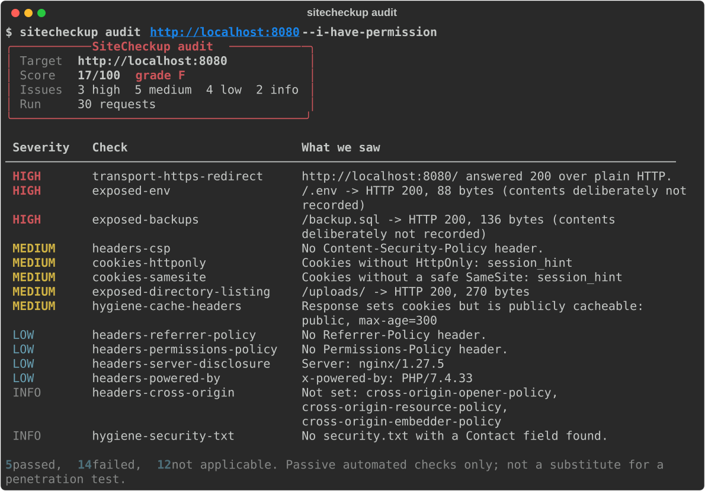

# SiteCheckup

[](https://github.com/ducampcarlos/SiteCheckup/actions/workflows/ci.yml)


[](LICENSE)

**SiteCheckup is a polite, passive command-line tool for the two moments a website is most likely to break: the day after a migration and the day a security report lands.**
`sitecheckup audit` inspects a live site with ordinary GET requests and produces a scored report with concrete remediation steps (TLS, security headers, cookies, exposed files, WordPress specifics, hygiene).
`sitecheckup compare` checks an old site against its migrated replacement, URL by URL, and tells you what broke: missing pages, redirect chains and loops, changed titles, canonicals, `noindex` leftovers, lost headers and slower responses. The `docs/` folder holds the playbooks that go with it.



> **Authorized use only.** Both commands refuse to run without `--i-have-permission`. Use SiteCheckup only on sites you own or have explicit written permission to test. See [SECURITY.md](SECURITY.md).
> **Not a pentest.** It is a fast, automated hygiene check. It does not replace a professional penetration test or a code review.

## Quickstart (60 seconds)

Requires Python 3.11+. The demo lab needs Docker (or a local nginx; see below).

```bash
git clone https://github.com/ducampcarlos/SiteCheckup.git && cd SiteCheckup
pip install .

docker compose up -d legacy-site new-site          # no Docker? run: make demo-local

sitecheckup audit   http://localhost:8080 --i-have-permission
sitecheckup compare http://localhost:8080 http://localhost:8081 \
    --i-have-permission --path-map demo/path-map.csv
```

The lab is two tiny nginx sites for an invented bakery with documented flaws ([`demo/README.md`](demo/README.md) lists exactly what each command should find). Sample output is committed in [`docs/examples/`](docs/examples/).
Prefer containers for the tool too? `docker compose --profile tools run --rm sitecheckup audit http://legacy-site --i-have-permission`.

## `audit`: passive security and hygiene check

```bash
sitecheckup audit https://example.com --i-have-permission                  # terminal summary
sitecheckup audit https://example.com --i-have-permission -o report.html   # self-contained HTML (+ summary)
sitecheckup audit https://example.com --i-have-permission -f json | jq .score
sitecheckup audit https://example.com --i-have-permission --fail-on high   # CI gate: exit 1 on any high finding
sitecheckup checks                                                         # list every check ID
```

* 31 checks, each a small class with a stable ID, severity (`info|low|medium|high`), description, evidence, remediation and OWASP/MDN references. They register themselves through a decorator, so adding one is a single file ([architecture](docs/architecture.md#adding-a-check)).
* Categories: transport (HTTPS redirect, TLS validity and expiry, HSTS), security headers, cookies, exposed files (`.git`, `.env`, backups, directory listing, phpinfo-style leftovers), WordPress (only when detected), hygiene (robots/security.txt, mixed content, caching).
* Score from 0 to 100 and grade A to F, with a documented formula: [docs/scoring.md](docs/scoring.md).
* Options: `--format html|json|md`, `--output FILE`, `--fail-on none|info|low|medium|high`, `--skip CHECK_ID`, `--rate`, `--timeout`, `--max-requests`, `-v`.

## `compare`: post-migration validator

```bash
sitecheckup compare https://old.example.com https://new.example.com --i-have-permission
sitecheckup compare OLD NEW --i-have-permission --urls-file urls.txt --path-map redirects.csv \
    --csv results.csv -o report.html --fail-on warning
```

* URL list from `--urls-file`, else the old site's `sitemap.xml` (only the *paths* are used), else a shallow same-host crawl that honours `robots.txt` (`--crawl` forces it, `--max-pages` caps it, default 100).
* `--path-map` is a CSV of intentional URL changes (`old_path,new_path`).
* Per URL it compares the final status, the redirect chain (flags chains longer than 2 and loops), `<title>`, meta description, canonical, `<h1>`, `noindex` (meta and `X-Robots-Tag`), security headers and response time.
* The report is organised as **Blocking / Warnings / OK**, plus a site-wide section for regressions that affect every page (such as a dropped security header). `--csv` exports one row per URL.
* Exit code 1 when anything is blocking (`--fail-on warning` is stricter, `--fail-on none` never fails).

Every issue has a stable code (`missing_on_new`, `noindex_added`, `canonical_points_to_old_host`, `redirect_chain_long`, `redirect_loop`, `title_changed`, `meta_description_lost`, `slower`, ...), documented in [docs/architecture.md](docs/architecture.md#compare-rules).

## Exit codes

| Code | Meaning |
| ---: | --- |
| 0 | Completed; nothing at or above the `--fail-on` threshold |
| 1 | Findings (`audit`) or differences (`compare`) at or above `--fail-on` |
| 2 | Usage error, invalid target, or `--i-have-permission` missing |
| 3 | Runtime error (target unreachable, request cap hit while collecting URLs) |

## Being a good citizen

SiteCheckup is deliberately polite, and none of this can be switched off from the command line:

* Identifiable `User-Agent` (`SiteCheckup/x.y.z (+https://github.com/ducampcarlos/SiteCheckup; passive-check)`).
* Rate limit (default 2 requests/second), per-request timeout, cap on bytes read per response, and a hard cap on requests per run (`audit` 150, `compare` 1000 by default).
* Redirects are only followed within the same site, so a scan can never wander off to a third party.
* `compare`'s crawler obeys `robots.txt`.
* GET/HEAD only. No payloads, no brute force, no fuzzing, no port scanning, nothing that modifies the target. Contents of exposed files such as `.env` are never stored in reports.

The reasoning is in [ADR 0001](docs/adr/0001-passive-only.md) and [ADR 0003](docs/adr/0003-permission-flag.md).

## Documentation

| | |
| --- | --- |
| [docs/architecture.md](docs/architecture.md) | How the pieces fit; how to add a check |
| [docs/scoring.md](docs/scoring.md) | The score and grade formula |
| [docs/adr/](docs/adr/) | Architecture decision records |
| [docs/playbooks/](docs/playbooks/) | Generic playbooks: [site migration](docs/playbooks/site-migration-checklist.md), [WordPress hardening](docs/playbooks/wordpress-hardening.md), [responding to a pentest report](docs/playbooks/responding-to-a-pentest-report.md), [working with clients and developers](docs/playbooks/working-with-clients-and-developers.md) |
| [docs/examples/](docs/examples/) | Sample reports generated against the demo lab |

All examples, fixtures and playbook scenarios are invented (`example.com`, `*.test`, `localhost`).

## Development

```bash
make install     # venv + editable install + pre-commit
make test        # pytest with coverage (fails under 85%)
make lint        # ruff check, ruff format --check, mypy --strict
make demo        # Docker lab + both commands (make demo-local without Docker)
make report      # regenerate docs/examples from a running lab
```

Tests never touch the network: HTTP is mocked with `respx` and sockets are blocked in `conftest.py`. See [CONTRIBUTING.md](CONTRIBUTING.md).

## Roadmap

Deliberately out of scope for 0.1, in rough priority order:

- [ ] Multi-page audit (sample N pages rather than the homepage only)
- [ ] Baseline files, so CI can fail only on *new* findings
- [ ] SARIF and JUnit output for code-scanning dashboards
- [ ] `compare`: image and asset checks, hreflang, structured data, JSON-LD diffs
- [ ] `compare`: HTML diff of main content to catch silently lost sections
- [ ] DNS/TTL pre-flight check for cutovers (resolver queries only)
- [ ] Optional vulnerability-database lookups for detected WordPress plugin versions
- [ ] Plugin entry points so third-party checks can ship as separate packages
- [ ] Published PyPI package and container image

## License

MIT, see [LICENSE](LICENSE). Copyright (c) 2026 Carlos Ducamp.
